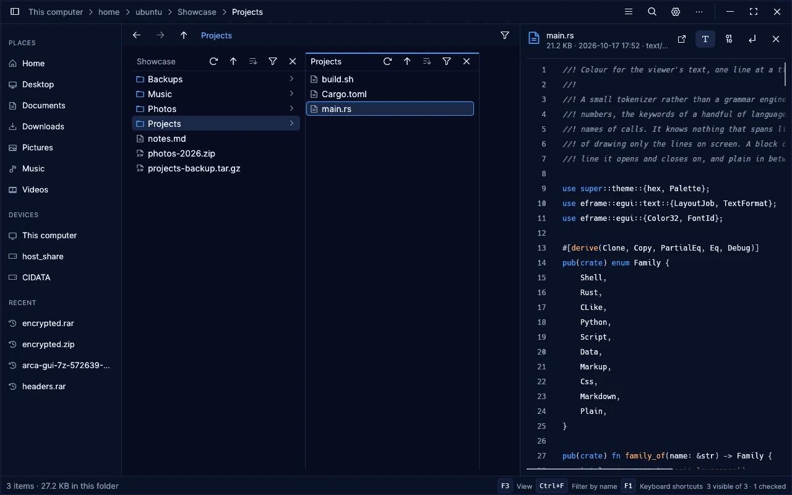
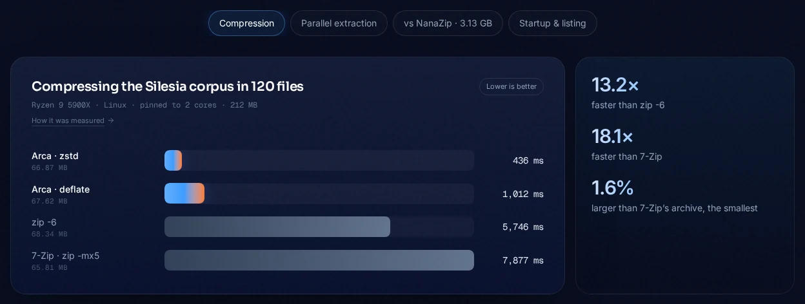

<div align="center">

<picture>
  <source media="(prefers-color-scheme: dark)" srcset="brand/arca-monolito-logotipo-blanco.svg">
  
</picture>

### Comprime rápido. Extrae seguro.

Un explorador de archivos y archivador en una sola ventana, escrito en Rust. Recorre el disco, entra en archivos ZIP, 7z, TAR y RAR como si fueran carpetas y comprime con Zstandard en paralelo y AES-256, con analizadores en Rust seguro.

[](https://github.com/beyondhumane/arca/actions/workflows/ci.yml) [](https://github.com/beyondhumane/arca/releases/latest) [](LICENSE) [](Cargo.toml)

**[Sitio web](https://arca.beyondhumane.com/es/)** · **[Descargar](https://github.com/beyondhumane/arca/releases/latest)** · **[Guía](docs/guide/es/README.md)**

[English](README.md) | **Español**

<br>



</div>

## De un vistazo

| Característica | Detalles |
|---|---|
| **Formatos** | ZIP con Zip64 (almacenado, Deflate, Zstandard; las entradas bzip2 se leen), [7z](docs/guide/es/creating-archives.md#7z) (LZMA2, LZMA, PPMd, BZip2, Deflate o almacenado, con filtros BCJ/ARM/ARM64/PPC/SPARC/IA-64/Delta; sólido), [creación de RAR5](docs/guide/es/rar.md#crear-archivos-rar5) (un solo volumen, cuatro niveles), TAR ustar, [`.tar.gz` y `.gz`](docs/guide/es/creating-archives.md#tar-y-gzip), [`.tar.xz` y `.xz`](docs/guide/es/creating-archives.md#xz), [`.tar.bz2`, `.bz2`, `.tar.zst` y `.zst`](docs/guide/es/creating-archives.md#bzip2-y-zstandard) |
| **Formas de salida** | [Volúmenes divididos](docs/guide/es/creating-archives.md#dividir-en-partes) (`-v 700m`: `.001`, `.002`… como los escribe y lee 7-Zip) y [programas de Windows que se extraen solos](docs/guide/es/creating-archives.md#programas-que-se-extraen-solos) (`--sfx`) |
| **Formatos de solo lectura** | [RAR/CBR existentes, también multivolumen](docs/guide/es/rar.md), activado por defecto; nunca se modifican y CBR nunca se crea |
| **Solo lectura** | [Contenedores ZIP](docs/guide/es/zip-containers.md): `.apk` `.aar` `.jar` `.war` `.ear` `.epub` `.cbz` `.xpi` `.whl` `.nupkg` `.ipa`; [imágenes ISO 9660](docs/guide/es/iso.md) con nombres Rock Ridge y Joliet; [CPIO, AR, DEB, RPM, CAB y LZH](docs/guide/es/more-formats.md); [imágenes de disco](docs/guide/es/disk-images.md): `.vhd` `.vhdx` `.vmdk` `.dmg` `.img`, con particiones MBR y GPT y FAT, exFAT, NTFS y HFS+ dentro |
| **Velocidad** | Compresión multihilo, extracción paralela de `.zip`, arranque en menos de un milisegundo |
| **Seguridad** | Analizadores con `#![forbid(unsafe_code)]`, lectura acotada de cabeceras, defensa contra Zip Slip |
| **Cifrado** | ZIP AES-256 (WinZip AE-2), con lectura también de AES-128 y AES-192; 7z AES-256 con nombres ocultos opcionales. [Límites](docs/guide/es/encryption.md) |
| **Escritorio** | `arca-gui`: un explorador de archivos que abre los archivos comprimidos en el mismo sitio. Paneles o vista de detalles, filtros por panel, vista previa con resaltado de sintaxis, hexadecimal e imágenes, vistazo a carpetas, foco con el puntero, dispositivos con montar, formatear y etiquetar, menús contextuales al estilo Strata, actualizaciones desde la propia aplicación |
| **Interfaces** | línea de comandos `arca`, ventana de escritorio `arca-gui`, menú del Explorador de Windows 11, menú de Dolphin y Abrir con en Linux |
| **Plataformas** | Windows, macOS (Apple silicon e Intel), Linux |

## Instalar

Descarga el archivo de tu plataforma desde la **[última versión](https://github.com/beyondhumane/arca/releases/latest)** (instalador de Windows o zip portable, tarballs de macOS y Linux), o compílalo:

```sh
cargo build --release          # binarios en target/release/
```

Los detalles, las sumas de comprobación y la compilación en Rust puro están en [Instalación](docs/guide/es/installation.md).

## La ventana

`arca-gui` arranca en la carpeta donde lo dejaste y se comporta como cualquier explorador de archivos: lugares, carpetas fijadas y dispositivos en la barra lateral, carpetas en paneles en paralelo o en una tabla de detalles, y un panel de vista previa que muestra texto con resaltado de sintaxis, volcados hexadecimales e imágenes. Haz doble clic en un archivo comprimido y se abre en el mismo sitio, con los mismos paneles, filtros y vista previa; **Comprimir** sobre cualquier selección y **Extraer** sobre cualquier archivo, con contraseña o sin ella, están a un clic derecho. Más en [El espacio de trabajo de escritorio](docs/guide/es/desktop-app.md).

## Inicio rápido

```sh
arca create photos.zip ~/Pictures/trip/    # el formato sale de la extensión
arca list photos.zip                       # mira dentro, sin extraer nada
arca test photos.zip                       # verifica cada CRC, sin escribir nada
arca extract photos.zip -o trip/           # descomprime
```

Más en la [Guía rápida](docs/guide/es/quick-start.md) y en la [Referencia de la CLI](docs/guide/es/cli-reference.md).

## Rendimiento

<div align="center">

</div>

Medido en una sola máquina y reproducible con `bash bench.sh`. Los [benchmarks](docs/guide/es/benchmarks.md) dan el método, cada ejecución y dónde pierde Arca.

## Documentación

<table>
<tr>
<td width="50%" valign="top">

**Para usarlo**
- [Introducción](docs/guide/es/introduction.md)
- [Crear archivos](docs/guide/es/creating-archives.md)
- [Listar y extraer](docs/guide/es/listing-extracting.md)
- [Cifrado](docs/guide/es/encryption.md)
- [Ventana de escritorio](docs/guide/es/desktop-app.md) · [Atajos](docs/guide/es/keyboard-shortcuts.md)
- [Integración con Windows](docs/guide/es/windows-integration.md)

</td>
<td width="50%" valign="top">

**Por dentro**
- [Arquitectura](docs/guide/es/architecture.md)
- [Interoperabilidad](docs/guide/es/interoperability.md)
- [Pruebas y benchmarking](docs/guide/es/testing-benchmarking.md)
- [Benchmarks](docs/guide/es/benchmarks.md)
- [Hoja de ruta](docs/guide/es/roadmap.md)

</td>
</tr>
</table>

## Contribuir

```sh
cargo test --workspace
bash interop.sh                # necesita zip, unzip, tar y 7-Zip
```

Se agradecen los informes de errores, los benchmarks de tu hardware y las pull requests. Lee antes [Contribuir](docs/guide/es/contributing.md) y [abre una incidencia](https://github.com/beyondhumane/arca/issues) para los errores.

## Licencia

[Apache-2.0](LICENSE)
